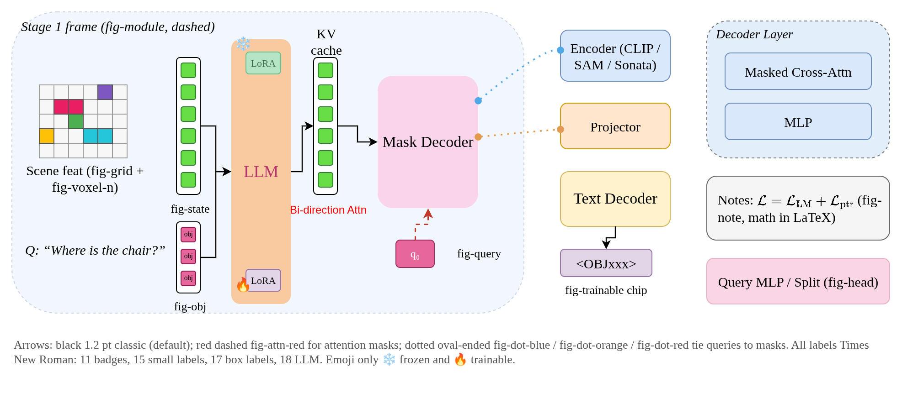
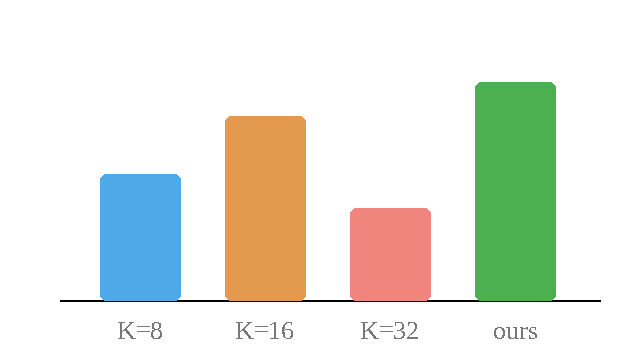
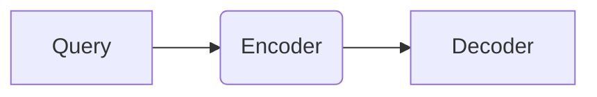
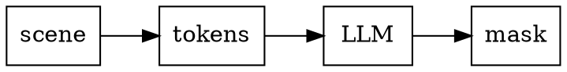

<!-- slide-maker gallery: one slide per slide type and component. Render it after every theme change
     (scripts/slides.sh assets/marp/gallery.md --pdf -o /tmp/gallery/) and read every page. -->

# Progress Report

Gallery Project
Nov. 5, 2026

# Section page: a question the block answers

[^sec]: Section pages may carry a footnote, e.g. the tracking issue: <https://github.com/torridfish/lrm/issues/1>

# Presenter name {.divider}

## Setup
### Lead, lists, inline marks and inline math

> A lead states the claim or the question; bold the **one term** the slide turns on.[^cited]

Plain paragraph with `a/config/key`, a [link](https://example.com), ==WIP==, [4-03]{.callout}, [a blocker]{.alert}, [the formula]{.formula} and [a tentative aside]{.faint}.

- Bullet list with inline math $\rho_{\mathrm{norm}} = \lVert\mathbf e\rVert / \tau\sqrt{D}$ and macros $\Lloss{LM}$, $\tok{OBJ}$
  - Second level
- ➔ A consequence

1. Ordered finding
   1. Sub-step
2. Second finding

[^cited]: A cited footnote, numbered in citing order.
[^uncited]: An uncited footnote goes to the slide it is written in.

## Experiment
### One figure with a run label (1:1, centred)



### Two figures in a row (the ## is repeated from the slide before)

 

### A picture and a GIF (the GIF moves in --html, a PDF shows its first frame)

 

## Setup
### Display math and an algorithm

$$
\Lloss{} = \Lloss{LM} + \frac{1}{4}\sum_{i=0}^{3}\big[\lambda\,\BCE(M_i,G) + \lambda\,\Dice(M_i,G)\big]
$$

```algo
\begin{algorithm}[H]
\Input{scene $S$, query $q$}
\Output{mask $M$}
$P \gets \mathrm{propose}(S)$\;
\For{$p \in P$}{
  $M \gets M \cup \mathrm{decode}(p, q)$ \Comment*[r]{per proposal}
}
\Return{$M$}
\end{algorithm}
```

## Analysis
### Numbered equations and a math fence

$$
\begin{equation}
p^*(r\mid\mathbf z)=\frac{\pi(r)\,\exp\!\big(-\lVert\mathbf z-\boldsymbol\mu(r)\rVert^2/2\tau^2\big)}{\sum_{r'}\pi(r')\,\exp\!\big(-\lVert\mathbf z-\boldsymbol\mu(r')\rVert^2/2\tau^2\big)}
\end{equation}
$$

```math
\begin{align}
a &= b + c \\
  &= d \notag \\
  &= e
\end{align}
```

$$
x = y \tag{A.1}
$$

## Benchmark
### Table and notes in two columns

<!-- _class: columns -->

| role | K | GSM8K | SVAMP |
| --- | --- | --- | --- |
| ref | 8 | 35.7 | 34.7 |
| a | 16 | 35.9 | 34.9 |
| b | 32 | **36.6** | **35.2** |

- The table hugs the left edge; this column takes the rest of the width
  - A nested point, two characters further in

## Analysis
### Equation slide (class equation)

<!-- _class: equation -->

$$
\boxed{\;\langle\mathbf e,\hat{\boldsymbol\Delta}\rangle>-\frac{\lVert\boldsymbol\Delta\rVert}{2}\;}
$$

## Benchmark
### Results table: role column, best numbers

| role | Name | Acc@0.25 | Acc@0.50 | Multiple Acc@0.25 | Unique Acc@0.25 |
| --- | --- | --- | --- | --- | --- |
| ref | 2-92 | 0.5505 | **0.4969** | 0.4685 | 0.8911 |
| a | 4-00 | **0.5186** | 0.4708 | 0.4319 | 0.8786 |
| | 4-02 | 0.4562 | 0.3170 | 0.3745 | 0.7957 |
| b | 4-03 | 0.4915 | 0.3482 | 0.4139 | 0.8136 |

- Notes under a table

## Related Work
### Settings table

| Representation | Space | Samplable | Examples |
| --- | --- | --- | --- |
| Discrete language | Native vocab | v | C3oT, CoT-Valve |
| Continuous hidden state | Model residual stream | – | Coconut, CODI |

{.settings}

## Setup
### Code with a path label and a first line number

```python {path="human_eval/execution.py" start=98}
def check_correctness(problem: dict, completion: str, timeout: float) -> dict:
    """Evaluates the functional correctness of a completion."""
    program = problem["prompt"] + completion + "\n" + problem["test"]
    result = unsafe_execute(program, timeout)  # sandboxed
    return dict(task_id=problem["task_id"], passed=result == "passed")
```

## Setup
### Two columns: code and a prompt template

<!-- _class: columns -->

```python
def has_close_elements(numbers: list[float], threshold: float) -> bool:
    for i, a in enumerate(numbers):
        for b in numbers[i + 1:]:
            if abs(a - b) < threshold:
                return True
    return False
```

```prompt
System: You are a helpful agent for indoor 3D scene understanding tasks.
User: {Scene info}\n\n{Task query}
Assistant: {Task response}
<|im_start|>system
```

## Reasoning quality
### Prose page with a body rule

<!-- _class: prose -->

**Helpfulness:** the reasoning model should generate $z = \mathrm{RM}(P)$ such that [$\delta$ is maximised]{.formula}.

[Other regularization is required; I'll check later.]{.faint}

<hr class="rule">

Logical consistency: currently no good idea about this part.

## Layout
### img-right: text in area a, the picture in b

<!-- _layout: img-right -->

::: a
- The text column takes the rest of the width
- The picture is as tall as the body allows, at most 1:1 and 62% of the width
:::

::: b

:::

### Custom areas, centred vertically

<!-- _layout: "a b" "a c" / auto 1fr middle -->

::: a
| K | GSM8K |
| --- | --- |
| 8 | 35.7 |
| 16 | 35.9 |
:::

::: b
- Area b, top right
:::

::: c center
**Area c, centred**
:::

## Review
### Callouts

> [!NOTE]
> A note with **bold** and $x^2$.

> [!TIP] A tip with its own title
> - and a list

> [!WARNING] Only a title

> [!CAUTION]
> Caution.

## Setup
### Diagrams: mermaid and dot





## Analysis
### A subsection that runs over

- First part

---

- Second part, under the same title and subtitle, numbered (2/2)

## TODO
### Week of Nov. 10

- **Summarize the new VAE results**
- ➔ Faithfulness on HumanEval once the machine is back

# Thanks for listening.
